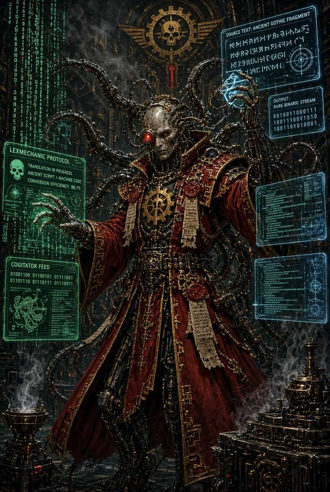
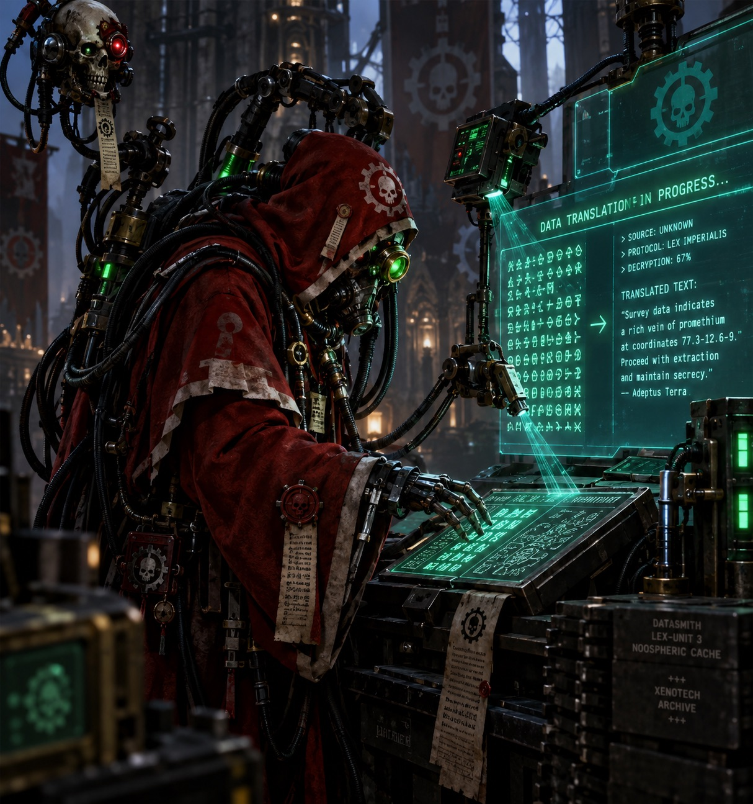

# Lexmechanic

<p align="center">
  
</p>

## Lore

<table>
<tr>
<td align="center" valign="middle" width="280">


</td>
<td valign="top">

> A Lexmechanic of the Adeptus Mechanicus, also known as a Calculus Logi, is a specialised Tech-Priest of the Adeptus Mechanicus whose primary duty is the collection, processing, analysis and organisation of information. They are the data specialists, computational analysts and technical archivists of the Imperium of Man.
>
> In the grim darkness of the 41st Millennium, information is power, knowledge is sacred, and an error in a calculation can condemn entire armies or planetary populations to death. The Lexmechanic's task is to ensure that the Imperium's vast machinery of war, industry and government continues to function through accurate information.

</td>
</tr>
</table>

### What does a Lexmechanic actually do?

- Data processing and translation

A Lexmechanic gathers raw information from cogitators, machine records, reports and other sources, then organises and interprets it into a useful form. This could involve turning thousands of military reports into a coherent operational summary or converting complex technical records into actionable instructions.

- Archiving sacred knowledge

Lexmechanics compile and rationalise information for storage in central cogitator repositories. They help maintain the enormous administrative and technical knowledge systems upon which the Imperium depends. Think of them as a combination of data analyst, archivist and highly specialised machine-assisted clerk.

- Statistical and military analysis

They process casualty reports, battlefield statistics, planetary assessments, industrial production figures and economic data. Their mathematical abilities can also be applied in the field, helping commanders interpret complex situations and calculate possible outcomes.

- Augmented cognition

Lexmechanics are known for processing information with computer-like speed and accuracy. Some undergo the Rite of Clear Thought, a neurological procedure described in the lore that enhances concentration and analytical ability while suppressing emotional distractions. This is not a universal requirement for every Lexmechanic.


## Usage

Lexmechanic is a small daemon. When you press a mouse side button, it takes a screenshot, crops it to the dialogue window, has an AI model translate the dialogue into Polish, and shows the result in a local web page, which it opens on start. Keep that page on the Steam Deck's built-in screen.

```sh
export GEMINI_API_KEY=...       # free key from https://aistudio.google.com/apikey
sbt linguaServitor/nativeLink  # sbt 2.x; also builds the UI and embeds it
bin=target/out/native0.5/scala-3.9.0/lingua-servitor/lexmechanic
$bin                           # daemon; opens the UI at http://127.0.0.1:7040
$bin trigger                   # translate now (e.g. from a KDE shortcut)
$bin translate shot.png        # one-off, prints to the terminal
```

For the binary you actually run on the Deck, build with `sbt release`. It writes the same path with an
optimized build; the debug `linguaServitor/nativeLink` is faster to link but runs the image code noticeably slower.

The code is split into three sbt modules:

| Module | Lore | What it is |
|---|---|---|
| `lingua-servitor/` | a mind-wiped worker bound to one task | the Scala Native daemon: hotkey, capture, PNG cropping, AI providers, HTTP server |
| `data-slate/` | the Imperium's handheld display | the Scala.js + Laminar page shown on the Deck's screen |
| `noosphere/` | the Mechanicus data-net its machines talk through | the models and JSON codecs, built for both |

In the UI, use **Calibrate** once to drag a box over the game's dialogue window. To pick the trigger, click the
**Hotkey** button and press the mouse button or key you want to use.

Settings are in `~/.config/lexmechanic/config.json`, which is created on first run:

| Key | Default | |
|---|---|---|
| `provider` | `gemini` | which API translates; see the table below |
| `model` | the provider's default | any vision model the provider offers |
| `apiKeys` | none | API keys by key variable, e.g. `{"GEMINI_API_KEY": "..."}`; a key not listed here is read from the environment |
| `captain` | `male` | gender of your Rogue Trader, used for Polish grammar |
| `port` | `7040` | |
| `captureCommand` | `spectacle` (Linux) / `screencapture` (macOS) | command as a JSON array of arguments, e.g. `["spectacle", "-b", "-n", "-f", "-o", "{file}"]`; `{file}` becomes the PNG output path |
| `openCommand` | `xdg-open` (Linux) / `open` (macOS) | opens the UI once the daemon starts; `{url}` becomes its address, `[]` turns it off |
| `region` | none | set by Calibrate |
| `hotkey` | `276` | evdev key code, set from the UI; `275` = mouse 4 ("back"), `276` = mouse 5 ("forward") |

Providers:

| `provider` | Key variable | Default model | Cost |
|---|---|---|---|
| `gemini` | `GEMINI_API_KEY` | `gemini-3.5-flash-lite` | free tier with a daily request limit, shown in AI Studio; free-tier prompts may be used to improve Google's products |
| `openrouter` | `OPENROUTER_API_KEY` | `google/gemma-4-31b-it:free` | free models; about 50 requests a day, 1,000 after a one-time $10 top-up |
| `mistral` | `MISTRAL_API_KEY` | `mistral-small-latest` | monthly free credits |
| `claude` | `ANTHROPIC_API_KEY` | `claude-opus-5-5` | paid |

### Steam Deck setup

- **Hotkey:** the daemon reads mouse buttons from `/dev/input` (evdev), which works under Wayland and while
  GeForce NOW has focus. Your user needs to be in the `input` group: `sudo usermod -aG input deck`, then log in again.
  Without that, bind `lexmechanic trigger` to a KDE custom shortcut instead.
- **Build:** the binary must be built on Linux. Use a distrobox container on the Deck
  (`distrobox create -i archlinux`, then install `clang`, `sbt` and `curl` inside it).
- **API key:** put it in `apiKeys`. A daemon started by KDE autostart does not see keys exported in your shell profile.
- **Display:** to open the UI full-screen, set `openCommand` to
  `["flatpak", "run", "org.mozilla.firefox", "--kiosk", "{url}"]`, then pin the window to the built-in screen with a
  KDE window rule.

---

<p align="center">
  
</p>
